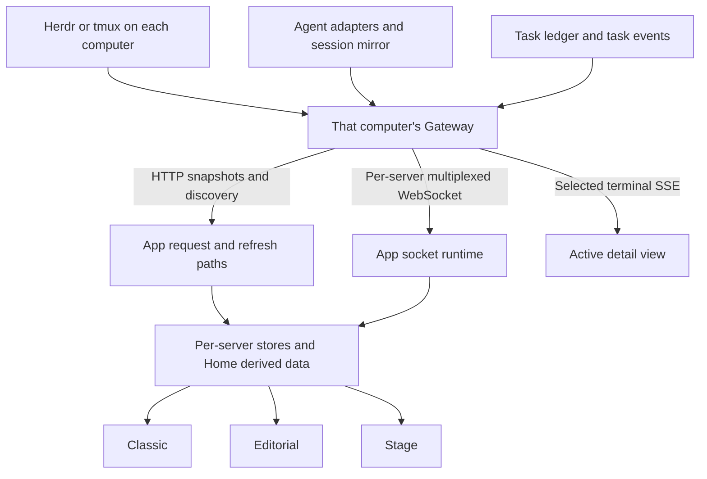
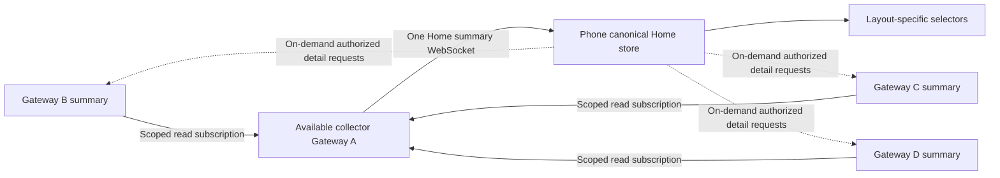

# Gateway and App Home data flow analysis

Date: 2026-10-24. Scope: static analysis of the current App working tree and sibling Gateway checkout. Existing uncommitted fixes are included in the observations. This document proposes boundaries and priorities; it does not implement or validate a new protocol. No battery savings or device behavior have been measured for these proposals.

## Decisions

1. Unify the Home data model, freshness policy, and request scheduling across Classic, Editorial, and Stage first. Layout choice should not determine data correctness.
2. Aggregate small, authorized Home summaries across computers when an available Gateway can serve as the collector. One phone WebSocket for these summaries is a reasonable target.
3. Fetch detailed sessions, terminal output, and bulk content only for active consumers. They do not belong in an always-on fleet summary stream.
4. Preserve explicit target identity, authorization, acknowledgments, and failure semantics for commands, messages, and approvals.
5. Update stores and components only when their observable values change. Connection consolidation alone does not achieve this.

Computers being mutually reachable is necessary for aggregation, but is not sufficient: the current peer protocol does not authorize a Gateway to read every other computer's sessions. Aggregation needs a new capability and a scoped read permission.

## Current flow

The Gateway box repeats for each computer. There is no existing fleet-wide Home feed.

### Gateway producers

| Producer              | Current behavior                                                                                | Consequence for aggregation                                                                    |
| --------------------- | ----------------------------------------------------------------------------------------------- | ---------------------------------------------------------------------------------------------- |
| Agent manager         | Updates session mirrors and broadcasts domain events; session events carry sequence information | Reuse domain events to derive bounded summaries instead of repeatedly reading full transcripts |
| Task service          | Persists task state and broadcasts updates                                                      | A good source for summary deltas; durable state still supplies recovery snapshots              |
| Terminal backend      | Reads Herdr/tmux state; session snapshot combines workspace, tab, pane, and agent reads         | One HTTP snapshot can trigger multiple backend operations                                      |
| Terminal activity hub | Shares a session activity source among subscribers; retires it when unused                      | Preserve subscriber-driven lifetime; avoid activating every terminal for Home                  |
| Fleet mirrors         | Follow delegated remote tasks and update local task mirrors                                     | Useful infrastructure, but not a complete remote computer inventory                            |

Gateway evidence: [agent manager](../gateway/src/agents/manager.rs), [task events](../gateway/src/tasks/events.rs), [terminal routes](../gateway/src/terminal/routes.rs), [fleet mirrors](../gateway/src/fleet/mirror.rs).

A terminal snapshot computes its response from backend state before deciding whether its content hash matches. A `304` can save response bytes without avoiding all backend work. Event-derived caches could save both, provided invalidation and recovery are correct.

### App consumers and refresh paths

| Path                     | Existing behavior                                                                                                                    | Main opportunity                                                                           |
| ------------------------ | ------------------------------------------------------------------------------------------------------------------------------------ | ------------------------------------------------------------------------------------------ |
| Home tasks               | `HomeTaskSync` mounts per eligible server; HTTP initial/recovery list plus task socket updates                                       | Shared freshness and subscription ownership across consumers                               |
| Recent/Continue sessions | Per-server refresh scheduling; periodic checks, snapshots, and agent-session reads depending on capabilities and remembered sessions | Summary events plus targeted recovery instead of routine full reads                        |
| Launch discovery         | `HomeLaunchActions` performs discovery refreshes and is mounted in the Editorial/Pad branch                                          | Move canonical discovery ownership out of layout-specific components                       |
| Reachability             | Combines socket state, probe results, and faults; direct probes have freshness limits                                                | Reuse authenticated successful contact; distinguish stale observations from proven failure |
| Composer pending replies | Reads full session snapshots; socket-triggered debounce and polling fallback                                                         | Push bounded reply/attention metadata; guard hidden consumers                              |
| Terminal/workbench       | Detail streams and fallback reads                                                                                                    | Keep demand-driven and independently scheduled                                             |

Evidence: [Home composition](src/components/home-overview.tsx), [task hooks](src/hooks/use-server-tasks.ts), [Continue component](src/components/home-recent-sessions.tsx), [Continue reads](src/lib/home-continue-refresh.ts), [refresh schedule](src/lib/home-refresh-schedule.ts), [launch actions](src/components/home-launch-actions.tsx), [composer](src/components/home-composer-dock.tsx).

There is already useful optimization: sockets are reused within a server, some GET requests are deduplicated in flight, refreshes have freshness/backoff policies, and sockets close when the App is inactive. This is not a system where every component necessarily creates a separate physical connection.

However, task freshness bookkeeping is local to each hook. Shared transport deduplication does not prevent every repeated read after an earlier request completes. A shared resource scheduler should own both in-flight work and completed-result freshness.

### Does four computers mean four times the work?

For N eligible direct servers with live task subscriptions, the phone can maintain approximately N server sockets. It does not imply exactly N times all requests or N times battery usage:

- Capabilities, visibility, SSH routing, offline status, remembered sessions, and freshness affect which reads actually run.
- Detail traffic depends on what the user opens and how active the agents are.
- Radio wakeups, bytes, decoding, derivation, and GPU activity all contribute differently.

The App's `MAX_PROBED_SERVERS = 4` limits a probe selection, not all computer connections. Gateway's `MAX_CONNECTIONS_PER_DEVICE = 4` limits connections from one device **to that Gateway**; it is not a four-computer fleet limit. Neither constant alone explains the reported fourth-card offline state.

Evidence: [reachability policy](src/lib/server-reachability.ts), [socket runtime](src/lib/gateway-socket-runtime.ts), [Gateway socket limits](../gateway/src/agents/ws_routes.rs).

## What should be consolidated?

Use payload size, change frequency, required latency, authorization, recovery semantics, and consumer visibility as the decision criteria.

| Data or behavior                              | Decision                                                   | Reason and boundary                                                                                                        |
| --------------------------------------------- | ---------------------------------------------------------- | -------------------------------------------------------------------------------------------------------------------------- |
| Computer identity and display metadata        | Shared canonical model; cache/version updates              | Small and reused by all layouts; bind identity to authenticated pairing, not a supplied name                               |
| Reachability observations                     | Aggregate, with source and observation age                 | Keep phone-to-collector and collector-to-source status separate; indirect reachability does not prove a direct phone route |
| Task state and progress summary               | Aggregate deltas                                           | Home needs state/counts and a bounded summary, not every output line                                                       |
| Attention, unread, pending approval counts    | Aggregate promptly                                         | Small and important; fetch sensitive details only when opened and authorized                                               |
| Recent session title/status/last activity     | Aggregate a bounded list                                   | Enough for Continue and cards; transcript stays outside the feed                                                           |
| Discovery, capabilities, default directory    | Share cached resource ownership; send changes/invalidation | Low-frequency metadata should not require independent layout timers                                                        |
| Selected computer's workspace/pane summary    | Conditional subscription                                   | Only if the visible Home view needs it; avoid keeping every backend activity source alive                                  |
| Terminal output                               | Active-session stream                                      | High-rate and ordered; do not broadcast every terminal to Home                                                             |
| Chat transcript and agent child tree          | Active-view subscription and incremental paging            | Potentially large; fetch only visible or explicitly tracked sessions                                                       |
| Files, images, uploads, large diffs           | Separate on-demand transfer                                | Independent cancellation, caching, pagination/range behavior, and backpressure                                             |
| Send message, execute command, approve/reject | Explicit targeted request and acknowledgment               | Do not silently replay ambiguous delivery or treat writes as replaceable summary events                                    |
| App background notifications                  | Separate lifecycle/push mechanism                          | A summary socket should not justify keeping the App continuously active in the background                                  |
| Selection, theme, gestures, clocks            | Local UI state                                             | No fleet round trip is needed                                                                                              |

“Separate” describes subscription and delivery semantics. An active session may reuse an existing socket if the protocol can provide isolation and ordering. There is no requirement to create a new physical socket for every logical topic. Conversely, forcing large detail traffic onto the summary socket creates avoidable contention.

WebSocket supplies bidirectional transport to an endpoint; fleet routing, permission checks, replay, and topic prioritization remain application responsibilities. See [RFC 6455](https://www.rfc-editor.org/rfc/rfc6455).

## Recommended topology

Gateway A also contributes its own summary. Prefer an already available, trusted computer; making a sleeping laptop the collector can worsen availability and energy use. A star suffices for one collector: a full mesh is not required for this feature.

With four computers, this can reduce Home's phone-facing sockets from roughly four to one. Peer connections and backend processing remain, and opening details may add traffic or connections. This is not evidence of a 75% energy reduction. If one computer is used, or no reliable collector exists, direct mode remains appropriate.

### Current protocol boundary

Gateway peers are explicitly forbidden from `subscribe`, `unsubscribe`, and `subscribe_all` session subscriptions. They may subscribe to task events, but ownership checks limit them to their authorized tasks. Fleet task mirrors cover delegated tasks, not all remote sessions.

Therefore, existing fleet links cannot simply be reused to expose all Home data. Add a separately negotiated, read-only summary capability and per-source grants. Do not forward App credentials to peers or expand task ownership permissions implicitly. Existing pairing and peer transport can be reused where their contracts fit.

Evidence: [peer restrictions and task ownership](../gateway/src/agents/ws_routes.rs), [peer identities](../gateway/src/fleet/peers.rs), [App fleet integration](src/lib/fleet-peers.ts).

### Recovery and status rules required before rollout

- Use source identity plus source generation, entity identity, and domain revision/cursor. Per-connection encryption sequence numbers are not replay cursors.
- Establish a snapshot watermark and deliver subsequent deltas without gaps. A gap resynchronizes only the affected source/topic, not the whole fleet.
- Keep explicit deletion events/tombstones. Do not order unrelated computers using wall-clock timestamps.
- Preserve origin identity for mirrored tasks so one delegated task is not counted twice.
- Bound queues. Coalesce replaceable progress updates, while preserving important transitions and unresolved attention. Recover via snapshot if a consumer falls behind.
- Keep slow bulk transfers out of the latency-sensitive summary path.
- Report collector transport state separately from each source's freshness. Collector failure means source observations become stale/unknown; it does not prove all computers are offline.
- Fall back to authorized direct reads with jitter and hysteresis. Switch producer ownership explicitly so old collector events cannot overwrite newer direct state.
- Never replay ambiguous commands or approvals automatically during failover.
- Revocation must stop collection and remove access to cached source data, not merely prevent the next connection.

The current Gateway has event broadcasts and resync signals, but not a complete durable fleet Home replay protocol. These requirements describe proposed work, not existing guarantees.

## Canonical Home model and three layouts

Use one domain data service with per-source resources, then let Classic, Editorial, and Stage project different views of the same facts.

Suggested conceptual slices, not an API contract:

- Computer metadata and capabilities.
- Route observations: direct transport, collector transport, source freshness, checked time, and failure reason.
- Task summaries keyed by source and stable task identity.
- Recent sessions keyed by source and session identity.
- Attention entities and derived scalar counts.
- Resource freshness, subscriptions, cursors, and in-flight reads, kept separate from displayed entities where possible.

Keep the viewed Home computer distinct from the globally selected terminal transport. Swiping a card can prioritize a freshness check for that computer without silently changing credentials or opening a terminal.

Today all three branches mount task synchronization, but discovery ownership is layout-dependent. Stage also subscribes to entire agent, attention, and task maps. Unifying the model should make the same computer show the same task/status facts across layouts, while allowing layout-specific visible subsets and animations.

## Component updates and power

A network event, a store update, a React render, and a GPU redraw are different operations. Optimize each boundary:

1. Gateway emits a semantic delta only when summary content changes.
2. App rejects stale/duplicate revisions and preserves references for unchanged entities.
3. Selectors subscribe to one computer, entity, or scalar count; avoid whole-fleet subscriptions in layout roots.
4. Derived lists retain stable identities when membership and visible values are unchanged.
5. Visible components update independently. Hidden views stop unnecessary subscriptions and computation.

React's external-store contract compares snapshot identity with `Object.is`; immutable, cached snapshots matter. It does not promise that network data is the only reason a component renders. Selection, clocks, theme, locale, and parent updates remain valid triggers. See [React useSyncExternalStore](https://react.dev/reference/react/useSyncExternalStore).

Specific findings:

- [Stage](src/components/home-stage/home-stage-layout.tsx) uses structural equality to stabilize derived panels, which can protect downstream rendering. Whole-map subscriptions still cause upstream rendering and panel derivation.
- [Task state](src/lib/server-tasks-state.ts) preserves unchanged identity on list replacement, but an accepted equal-time upsert can still replace a task/array. Separate receipt bookkeeping from displayed semantic data before suppressing updates; do not break stale-list protection.
- [Composer](src/components/home-composer-dock.tsx) gates fallback polling by visibility, but its socket-triggered snapshot path needs equivalent visibility policy.
- [Workbench](src/components/agent-workbench.tsx) has child-tree fallback reads that deserve an explicit active/visible guard.
- Stage already uses demand rendering and focus/background motion controls. Visible repeating status animations are a separate GPU cost; a single socket does not remove it. See [Stage motion policy](src/lib/home-stage-motion.ts).

## Intelligent scheduling without unnecessary complexity

Use a small explicit policy based on observable demand rather than guessing user intent:

| Situation                          | Suggested policy                                                                                   |
| ---------------------------------- | -------------------------------------------------------------------------------------------------- |
| Home visible, selected computer    | Fresh summary; prioritize stale checks on selection; share in-flight checks                        |
| Home visible, other computers      | Small summary deltas; no full transcript/tree reads                                                |
| Detail view open                   | Subscribe to that detail; retain only necessary fleet attention summaries                          |
| No visible consumer                | Release detail subscriptions and stop related refresh timers                                       |
| App background                     | Suspend foreground sockets/polls; use an appropriate background notification path                  |
| Healthy event stream               | Avoid routine full snapshots; perform bounded reconciliation where producer coverage is incomplete |
| Source disconnected                | Mark observation stale, retain cached data, back off with jitter                                   |
| Reconnect or detected sequence gap | Targeted snapshot/replay, then resume deltas                                                       |
| High event rate                    | Coalesce replaceable summaries; preserve critical transitions and apply backpressure               |

Centralize scheduling by source and resource, not in individual layout components. Reuse authenticated successful contact as evidence of reachability, without inventing health metadata that was not returned. Probe only when the required freshness cannot be satisfied from existing observations.

Removing fallback polls is safe only after the producer covers all relevant changes and recovery is reliable. Discovery or external tmux changes may still need bounded reconciliation. “Event-driven” must not become “silently stale.”

## Implementation priority, if later authorized

| Order | Work                                                                                                     | Reason                                                                               |
| ----- | -------------------------------------------------------------------------------------------------------- | ------------------------------------------------------------------------------------ |
| 1     | Instrument reads, bytes, renders, subscriptions, and visibility                                          | Establish where energy and redundant work actually go                                |
| 2     | Unify Home resource ownership and layout projections; fix visibility gaps and duplicate semantic updates | Benefits both direct and aggregated modes with less protocol risk                    |
| 3     | Add a local Gateway Home summary feed built from existing events/cache                                   | Prove summary semantics and recovery on one computer                                 |
| 4     | Add scoped peer summary grants, source cursors, and collector aggregation                                | Enables one phone-facing summary stream without broadening existing task permissions |
| 5     | Add direct fallback, revocation, bounded queues, and gradual capability-based rollout                    | Preserve correctness under failure and mixed Gateway capabilities                    |

Defer proxying all terminal output, all files, and command execution through the collector. Their costs and failure semantics require separate justification.

## Validation needed to substantiate savings

Compare Release builds on the same dedicated QA device and state, with at least two runs per side. Keep screen brightness, layout, network, thermal conditions, and workload comparable. Measure device energy and traffic; connection count alone is insufficient.

Test one, four, and eight sources across idle Home, active task progress, terminal streaming, card swipes, hidden Home, background/foreground, source disconnect, collector loss, reconnect gaps, revocation, and a slow consumer.

Collect:

- Phone requests/minute by endpoint/source, response bytes, socket messages, reconnects, and timer wakeups.
- JSON/decryption and selector work, component commit counts, frame/GPU activity, and battery/energy measurements.
- Gateway backend reads/process work, peer traffic, queue pressure, and summary cache hit rates.
- Update latency, stale-observation duration, missed/duplicate transitions, and consistency across all three layouts.

Acceptance requires both less measured unnecessary work and preserved correctness: a quiet unchanged fleet should not trigger recurring full-session reads; a changed task should update the affected summary promptly; reconnect should recover without double counting; a missing collector should not label all source computers definitively offline.

No runtime, device, or battery tests were run for this document. The reported mini status issue remains unverified on the user's device; this architecture review does not establish its root cause or claim that aggregation fixes it.
