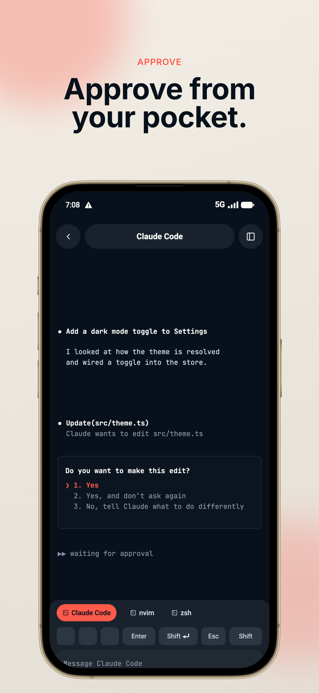
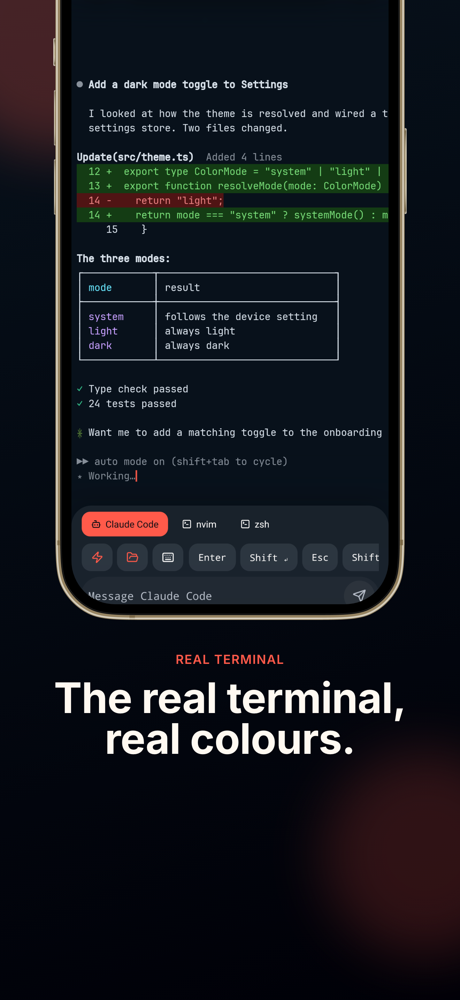
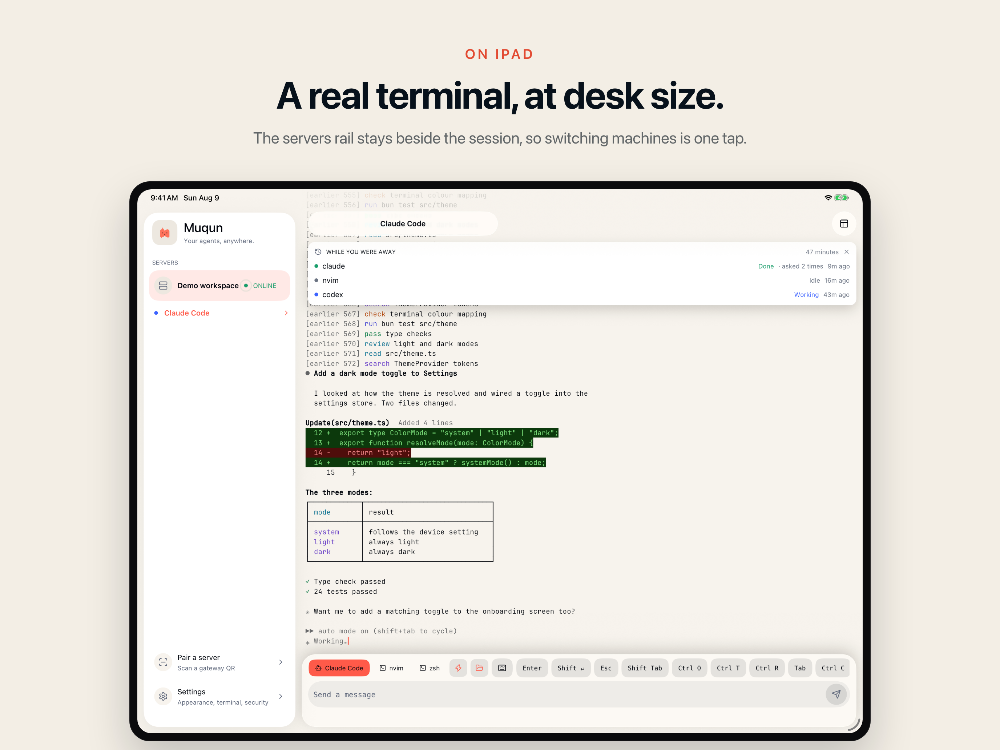

# Muqun

**Watch and answer the coding agents running on your own computer, from your phone.**

You start an agent, it says twenty minutes, and you go and make coffee. Eight
minutes in it stops to ask whether it may delete a file — and then it sits
there, doing nothing, until you are back at the keyboard.

Muqun is the other half of that session. The question arrives as a push you can
answer from the Lock Screen, and behind it is the real terminal: the same grid,
the same colours, the same keys, on a phone or an iPad.

It talks to a [Gateway](https://github.com/osuki-dev/muqun-gateway) you install
on your own machine. There is no Muqun account, no hosted relay, no analytics
and no advertising, and nothing of yours passes through a server of ours —
because there isn't one.

| Approve from wherever you are                                                                                                                                    | The real terminal, not a log view                                                                                                                                             |
| ---------------------------------------------------------------------------------------------------------------------------------------------------------------- | ----------------------------------------------------------------------------------------------------------------------------------------------------------------------------- |
|  |  |

## What it does

- **Answers the question.** The permission prompt arrives as a push —
  Approve, Approve always, Deny — from the Lock Screen, without opening the
  app. On iOS a Live Activity keeps the terminal you are watching on screen; on
  Android there is a home-screen widget.
- **Draws a real terminal.** Output goes onto a terminal grid in the program's
  own colours, so diffs, tables, spinners and TUIs look the way they look on
  your desk. Long-press to select and copy the exact bytes.
- **Sends real keys.** The on-screen row is laid out like a keyboard and every
  key sends the moment you press it, so nvim, `less` and REPLs behave. Editor
  terminals get vim's key row and follow nvim's current mode.
- **Finds its way around a busy machine.** One sheet outlines the whole
  workspace — every group, every terminal, addressed the way tmux addresses it — and
  you can open a port on that machine in your phone's browser.
- **Delegates without losing your place.** Quick actions → Agent collaboration
  sends a task to a ready assistant or starts another in the same project.
  Follow its status and inspect recent output in the same sheet; opening its
  terminal is a separate, deliberate action.
- **Looks like your setup.** 32 theme packs, each with a light half and a dark
  one, repainting the app and the terminal together. Eleven languages: English,
  繁體中文, 简体中文, 日本語, 한국어, Deutsch, Français, Español, Português,
  Русский, Tiếng Việt.

No Gateway yet? "Try the demo" on the home screen runs the whole app on sample
data bundled in the binary, offline, with no network request of any kind.

## Get it

  
  

  
    iPhone, iPad and Android · no account, no subscription
  

<!--
  The two badges are the stores' own artwork, kept in `assets/readme/` rather
  than hotlinked, so a fork, a mirror or an offline clone renders the same page.

  Google ships its badge with 32.8% of the image height as transparent padding
  (the button is 564x168 inside a 646x250 file); Apple ships its with none. The
  copy here is trimmed to that ink box, so both files are the button and nothing
  else and both can be set to the same height.

  Do not "fix" this by giving Google's badge a taller height instead. GitHub
  strips `style` from README HTML, so there is no vertical-align to reach for,
  and two inline images sit on one baseline: a padded badge scaled up until its
  button matches leaves that button floating about 12px above the other one.
  That was the first version of this block and it is what it looked like.

  Both anchors are written with no whitespace inside them, on purpose. A newline
  between `` and `</a>` is a text node inside a link, and GitHub underlines
  it -- a small blue dash hanging off the App Store badge.

  Muqun is not sold in the mainland China storefront. The link carries no
  country segment, so Apple sends each visitor to their own storefront and a
  visitor in one that does not sell it lands on Apple's front page. That is the
  storefront, not a dead link, and hardcoding /us/ would break it for everyone
  else.
-->

## Licence

Apache License 2.0 — see [`LICENSE`](LICENSE) and [`NOTICE`](NOTICE).

**The names and the logo are not covered by that licence.** Fork it, build it,
change it, ship what you build — under your own name. See
[`TRADEMARK.md`](TRADEMARK.md), which is short and says exactly what is and is
not allowed.
